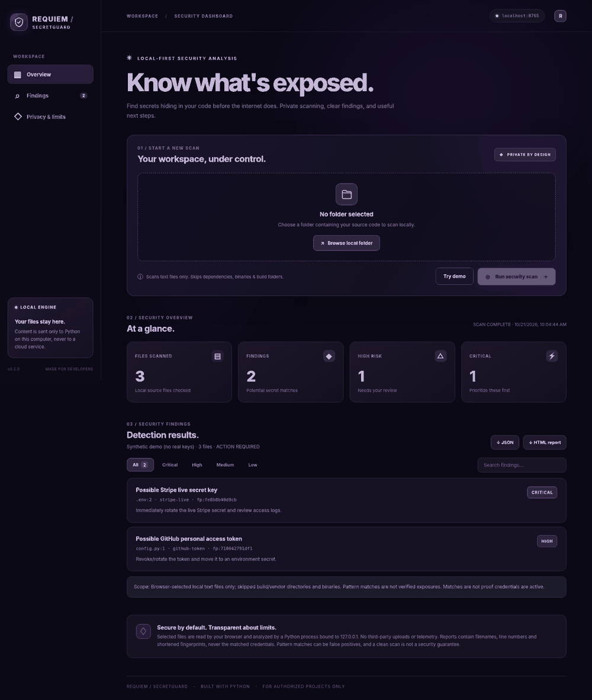

# REQUIEM / SecretGuard

**Local-first secret scanner for developers.** Detect credential-like patterns using a Python CLI, a private dashboard, **or an on-demand Chrome extension**, with redacted reports.

  

## NEW in v0.3: Chrome / Edge extension

**No Python or server is needed to use the extension.** Open `chrome://extensions`, enable Developer Mode, click **Load unpacked**, and select the project’s `extension/` folder. Visit a web app that you own or are authorized to inspect, click SecretGuard, confirm permission, and press **Run security scan**. You can export redacted JSON findings. To safely test detection, keep the local Python dashboard running and open **http://127.0.0.1:8765/extension-demo**; its JavaScript uses intentionally fake patterns. See [extension/README.md](extension/README.md) for limitations, privacy details, and troubleshooting.

The extension checks inline and same-origin JavaScript with bounded, credential-free fetches. It does not inspect cross-origin bundles, private account traffic or active requests. Browser extension findings and Python CLI findings have different scopes.

## v0.2: Local web dashboard



**On Windows:** Unzip the project and double-click **`start_secretguard_windows.bat`**. Keep the terminal open. The dashboard opens in your default browser.

**Windows / macOS / Linux terminal:**

```bash
python -m secretguard.web
```

Then open **http://127.0.0.1:8765/** in Chrome or Edge. No installation of external Python libraries is required when running from the unpacked project folder. `Ctrl+C` stops the local server.

1. Press **Browse local folder**, select a project folder in Chrome / Edge, and approve access to the selected files.
2. Press **Run security scan**. The browser sends text content **only to a Python service listening on your own 127.0.0.1**; the service processes it in memory and does not store the raw files.
3. See findings, search/filter by severity, and download JSON or standalone HTML reports.
4. Press **Try demo** to scan invented sample credentials without selecting real code.

The browser preview is limited to 1000 in-scope files, 1 MB per file, and 7 MB of selected text total. It excludes dependency/build folders and known binary formats. Oversized files mark scan coverage **INCOMPLETE**; too many files or too much total text displays an error rather than claiming a clean scan. Some browsers may not include hidden files in folder selections. For large projects and a more complete local filesystem view, use the CLI below. Folder selection requires a browser supporting `webkitdirectory` (Chrome/Edge recommended).

The dashboard works only on your computer and is intentionally **not** a public website. The local server accepts only requests from its own origin and binds to loopback. Do **not** expose or proxy port 8765 publicly. No account, internet, or API key is needed.

## Features

- Detect common GitHub / GitLab / Slack / Stripe credentials, AWS access-key IDs and PEM private-key headers
- Look for suspicious generic hardcoded assignments like `api_key = "..."`
- Show path, line number, severity, SHA-256 fingerprint and remediation tip
- **Never store or print actual matched values** in reports
- Generate **text**, **JSON**, and **single-file offline HTML** reports
- Bound scans with file/byte limits and mark coverage gaps as incomplete
- No external cloud uploads, accounts, telemetry, or third-party runtime dependencies; the optional UI sends data only over local loopback; the optional extension can fetch same-origin scripts after explicit user initiation
- GitHub Actions tests and a synthetic local demo

## Install

Requires Python 3.10+.

```bash
python -m pip install -e .
```

Or run from a checkout without installing:

```bash
python -m secretguard .
```

## Usage

```bash
# Scan a local folder that belongs to you
python -m secretguard /path/to/your/project

# Save a visual report
python -m secretguard /path/to/your/project --format html --output report.html

# Structured output for automation
python -m secretguard /path/to/your/project --format json --output report.json

# Determine which severity triggers a nonzero exit code
python -m secretguard /path/to/your/project --fail-on medium
```

Exit codes: `0` no findings at selected threshold and full in-scope coverage, `1` execution error, `2` findings at the selected threshold **or incomplete coverage**. Using `--fail-on off` does not disable incomplete coverage reporting.

### Safe demo

Create synthetic examples locally and scan them:

```bash
python scripts/make_demo.py
python -m secretguard demo-target --format html --output report.html
```

Open `report.html` in your browser. **Synthetic keys in the demo are not valid and must not be used as credentials.**

### Run tests

```bash
python -m unittest discover -s tests -v
```

## What it does *not* do

- It does not verify credentials online, discover domains, attack sites, perform exploit testing, or scan browser traffic.
- It does not inspect ZIP/binary files, git history, or vendor/build directories in this version.
- The scanner can miss secrets (false negatives) or flag benign strings (false positives). An empty report is not a guarantee of safety.
- Files larger than 1 MB (by default) and scan-limit interruptions generate coverage warnings. Symlinks are not followed.
- Paths and file locations appear in reports, so treat reports as internal security documents.

Use on your own or explicitly authorized files. If a real key has leaked, revoke it, rotate it, remove it from code and investigate repository history.

- [x] Local web dashboard with folder picker, filters, and HTML/JSON download
- [x] Chrome / Edge extension for manual, scoped inspection of page JavaScript

## Roadmap

- [ ] Scan git history for accidentally committed credentials
- [ ] SARIF export for code scanning
- [ ] More detector signatures and better false-positive reduction
- [ ] Optional allowlist file with documented suppressions

## Tests / CI

The included GitHub Actions workflow runs Python dashboard/scanner tests and JavaScript extension tests on every push or pull request. Locally:

```bash
python -m unittest discover -s tests -v
node --test extension/tests/*.cjs
```

## Attribution

This is an original, smaller educational implementation inspired by the idea behind [KeyLeak Detector by Amal-David](https://github.com/Amal-David/keyleak-detector). No source code was copied. KeyLeak has significantly broader coverage and separate browser / BaaS scanning functionality.

## License

MIT License, © 2026 Charoskhon Farkhadova.
